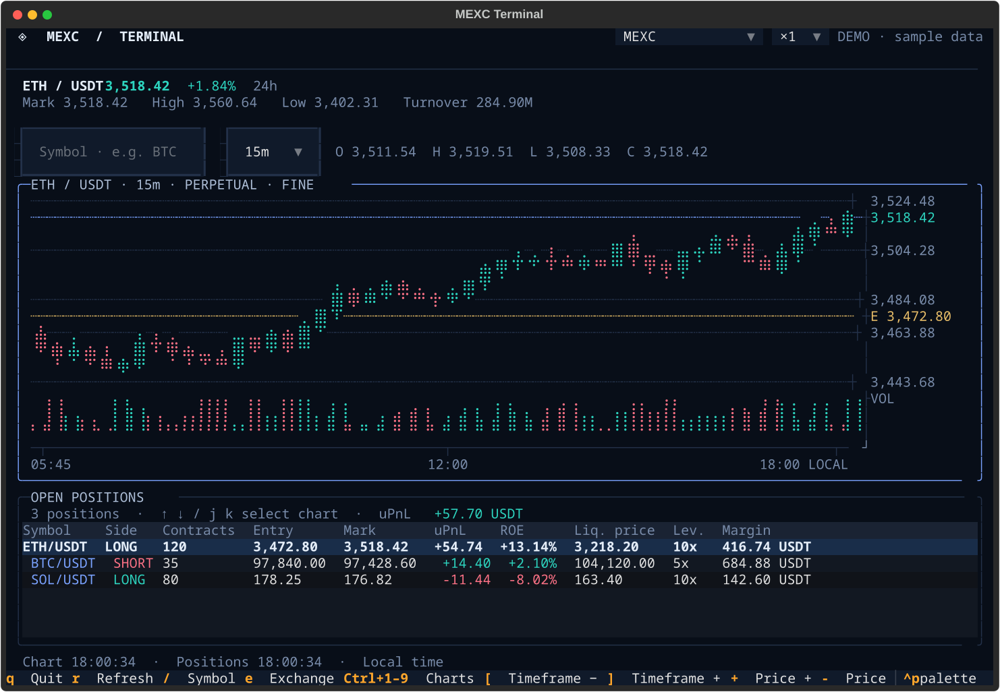

# perpetui

[English](README.md) | **日本語**

Hyperliquid、Lighter、MEXC の先物チャートと、保有しているポジションをターミナルで確認するためのアプリです。

相場を見るだけならブラウザーでも十分なのですが、複数の銘柄を並べたいときや、ポジションとチャートを一つの画面で確認したいときには少し面倒なところがあります。

というわけで、Python の Textual と Plotext を使って TUI にしました。起動は Go のランチャーから行います。

**注文や決済を実行する機能はありません。** 相場とポジションを確認するためのツールです。



## とりあえず起動する

Python 3.11 以上、Go 1.23 以上、make と ANSI / UTF-8 対応の端末が必要です。画面は 120 列 × 40 行以上を推奨しています。

```sh
git clone https://github.com/haturatu/perpetui.git
cd perpetui
make install
perpetui --demo
perpetui --demo=portfolio
```

`perpetui --demo` は単一取引所のサンプル画面、`perpetui --demo=portfolio` は
Hyperliquid 2 口座・MEXC・Lighter をまとめた統合ポートフォリオのサンプル画面です。
どちらも設定ファイルなしで起動できます。

`make install` で、既定では `~/.local/bin/perpetui` と専用の Python 環境、シェル補完、man ページをインストールします。`~/.local/bin` に PATH が通っていない場合は追加してください。

Python の依存解決は uv を優先し、入っていなければ venv と pip に切り替えます。Go のバイナリをビルドするのに Go が必要ですが、**インストール済みのバイナリを起動するだけなら Go は不要**です。

インストール先を変える場合や pip を明示的に使いたい場合は[インストール手順](docs/installation.ja.md)を参照してください。

## 取引所を選ぶ

既定は Hyperliquid です。監視するアカウントを指定しなければ公開相場だけを表示します。

```sh
perpetui --public
perpetui --exchange lighter
perpetui --exchange mexc
perpetui --symbol SOL --interval 1h --lang ja
```

| 取引所 | ポジションを見るために必要なもの | 数量の単位 |
| --- | --- | --- |
| Hyperliquid | ウォレットアドレス、または hl の保存済み設定 | 銘柄の実数量 |
| Lighter | アカウント番号、または lighter の保存済み設定 | 銘柄の実数量 |
| MEXC | API キーとシークレット、または mexc-cli の保存済み設定 | 契約枚数 |

Hyperliquid と Lighter は、秘密鍵を使わずに監視先を指定できます。一方、MEXC のポジション取得には認証設定が必要です。アカウントの読み込み順やテストネット、通信先は[取引所の設定](docs/exchanges.ja.md)にまとめています。

## 複数アカウントと統合ポートフォリオ

異なる取引所のポジションを一緒に確認したい場合は、
`~/.config/perpetui/config.toml` に監視対象を登録できます。
設定ファイルがなければ、従来の単一アカウントの起動方法のままです。

```toml
[portfolio]
default_view = "all"
group_by = "symbol"

[[accounts]]
id = "hl-main"
exchange = "hyperliquid"
account = "main"

[[accounts]]
id = "hl-sub"
exchange = "hyperliquid"
wallet_address = "0x0000000000000000000000000000000000000000"

[[accounts]]
id = "mexc-main"
exchange = "mexc"
account = "main"

[[accounts]]
id = "lighter-main"
exchange = "lighter"
lighter_account_index = 12345

[[portfolios]]
id = "trading"
accounts = ["hl-main", "mexc-main"]
```

アドレスとアカウント番号は実際の値に置き換えてください。MEXC の API キーはこの設定ファイルに書かず、
既存の mexc-cli の保存済みアカウントを参照します。
`--config /path/to/config.toml` でも指定できます。

設定ファイルを作らずに統合表示だけを確認したい場合は、`perpetui --demo=portfolio` を実行してください。
Hyperliquid 2 口座・MEXC・Lighter のサンプルアカウントと、`hedge` / `all-venues` ポートフォリオが
組み込まれています。取引所の認証情報は読みません。

ポジション欄では全取引所・個別取引所・アカウント・名前付きポートフォリオを切り替えられます。
並び順は通常・取引所別・銘柄別から選べます。さらに「Exposure」に切り替えると、
銘柄別のロング・ショート実数量、ネット・グロス数量、ロング比率を確認できます。
この画面では取引所別・通貨別の証拠金も表示します。チャートの上部にある取引所選択は、
統合モードでは**選択中のチャート枠のみ**に適用されます。
ポジション行を選択すると、その取引所のチャートに切り替わります。
別の枠や他の取引所のポジション監視は継続します。

合計 uPnL は USDC、USDT など通貨別に計算します。
数量のネット・グロス集計は換算可能な線形契約に限定し、清算価格・レバレッジ・ROE は合算しません。
任意で `[portfolio.fx_rates]` に `USDC = 1.0` のように手動レートを設定すると USD 換算参考値を表示できます。
為替レートを明示しない場合、USD 換算の合計は表示しません。
接続できないアカウントは STALE と表示し、最後のスナップショットを残します。

## 複数チャートとポジション

複数チャートを並べると、画面の横幅によっては無駄な空きが出ます。なので、既定の Auto 配置では、チャート数とターミナルの幅・高さに合わせて枠を組み替えます。

例えば 3 枠なら「上 1・下 2」、5 枠なら「上 3・下 2」といった形にもできます。配置を変えても、表示中のチャートの履歴や購読はそのままです。

ポジション欄も固定の高さではありません。**ポジションが 0 件なら折りたたみ、件数が少なければ小さく表示**します。空いた領域はチャートに使います。

同じ取引所・銘柄・時間足を複数枠で表示する場合は、通信を共有します。ただし履歴カーソル、拡大率、表示形式は枠ごとに持っています。

### よく使うキー

| キー | 操作 |
| --- | --- |
| `?` | ショートカット一覧 |
| `Ctrl + 1〜9` | チャートの表示数を変更 |
| `1`〜`9` | 操作するチャートを選択 |
| `l` | Auto / Horizontal / Grid / Vertical を選択 |
| `/` | 銘柄を検索 |
| `e` | 取引所を切り替え（統合モードでは選択中のチャートのみ） |
| `[` / `]` | 時間足を変更 |
| `←` / `→`、`End` | 過去の足を見る／最新に戻る |
| `z` | チャートを最大化／元に戻す |
| `p` / `Shift + P` | ポジション欄の手動表示／自動表示へ戻す |
| `r` | 更新 |
| `q` / `Ctrl + C` | 終了 |

全体の時間足同期、価格軸の拡大、銘柄検索、Konsole で Ctrl + 数字が効かないときの設定は[操作方法](docs/usage.ja.md)を参照してください。

## 開発する場合

インストールせずに動かしたいなら、リポジトリ内で次のように実行できます。

```sh
make setup
uv run perpetui --demo
```

uv がない環境でも `make setup` は pip を使えます。その場合の起動方法は[インストール手順](docs/installation.ja.md)に記載しています。

テストや静的解析は以下です。

```sh
make check
uv build
```

[開発メモ](docs/development.ja.md)と[アーキテクチャ](docs/architecture.ja.md)に内部構成をまとめています。コマンドの全オプションは `perpetui --help` または `man perpetui` から確認できます。
