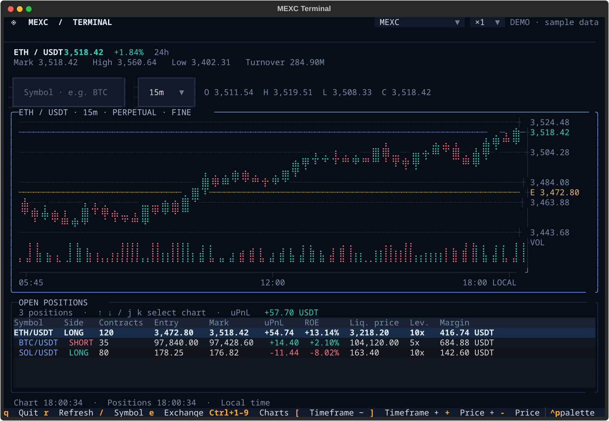

# perpetui

**English** | [日本語](README.ja.md)

perpetui is a terminal application for viewing futures charts and open positions on Hyperliquid, Lighter, and MEXC.

A browser is fine for checking market prices, but it becomes inconvenient when you want to put several symbols side by side or see your positions and charts on the same screen.

So I built a TUI with Python's Textual and Plotext. A Go launcher starts the application.

**perpetui cannot place or close orders.** It is a read-only tool for monitoring markets and positions.



## Get started

You need Python 3.11 or later, Go 1.23 or later, `make`, and an ANSI/UTF-8-capable terminal. A terminal of at least 120 columns × 40 rows is recommended.

```sh
git clone https://github.com/haturatu/perpetui.git
cd perpetui
make install
perpetui --demo
perpetui --demo=portfolio
```

`perpetui --demo` opens a single-exchange sample. `perpetui --demo=portfolio` opens a combined portfolio sample with two Hyperliquid accounts, MEXC, and Lighter. Neither mode requires a configuration file.

By default, `make install` installs `~/.local/bin/perpetui`, a dedicated Python environment, shell completions, and a man page. Add `~/.local/bin` to your `PATH` if necessary.

Python dependencies are resolved with uv when available, or with venv and pip otherwise. Go is required to build the launcher, but **not to run an already installed binary**.

See [installation](docs/installation.md) to change the installation paths or explicitly use pip.

## Choose an exchange

Hyperliquid is the default. Without an account to monitor, perpetui only displays public market data.

```sh
perpetui --public
perpetui --exchange lighter
perpetui --exchange mexc
perpetui --symbol SOL --interval 1h --lang ja
```

| Exchange | Required to monitor positions | Quantity unit |
| --- | --- | --- |
| Hyperliquid | Wallet address or saved `hl` configuration | Actual asset quantity |
| Lighter | Account index or saved `lighter` configuration | Actual asset quantity |
| MEXC | API key and secret or saved `mexc-cli` configuration | Number of contracts |

Hyperliquid and Lighter can monitor an account without a private key. MEXC requires authentication to retrieve positions. See [exchange configuration](docs/exchanges.md) for account lookup precedence, testnets, and endpoints.

## Multiple accounts and combined portfolios

To monitor positions across several exchanges at once, register the accounts in `~/.config/perpetui/config.toml`. Without this file, the original single-account mode still works.

```toml
[portfolio]
default_view = "all"
group_by = "symbol"

[[accounts]]
id = "hl-main"
exchange = "hyperliquid"
account = "main"

[[accounts]]
id = "hl-sub"
exchange = "hyperliquid"
wallet_address = "0x0000000000000000000000000000000000000000"

[[accounts]]
id = "mexc-main"
exchange = "mexc"
account = "main"

[[accounts]]
id = "lighter-main"
exchange = "lighter"
lighter_account_index = 12345

[[portfolios]]
id = "trading"
accounts = ["hl-main", "mexc-main"]
```

Replace the example address and account index with your own. Do not put MEXC API keys in this TOML file; use an existing saved `mexc-cli` account instead. You can also specify the file with `--config /path/to/config.toml`.

To try the combined view without creating a configuration file, run `perpetui --demo=portfolio`. It includes two sample Hyperliquid accounts, MEXC, Lighter, and the predefined `hedge` / `all-venues` portfolios. No exchange credentials are read.

In the positions panel, you can switch between all exchanges, an individual exchange, an account, and a named portfolio. Positions can be shown in their normal order or grouped by exchange or symbol. The `Exposure` view shows long and short actual quantities by symbol, net and gross quantities, and long ratios. It also shows margin grouped by exchange and currency.

In combined mode, the exchange selector above the charts affects **only the currently selected chart pane**. Selecting a position switches that pane to the position's exchange. Other panes and positions from other exchanges continue updating.

Total unrealized PnL is calculated separately for settlement currencies such as USDC and USDT. Net and gross quantity aggregation applies only to convertible linear contracts; liquidation prices, leverage, and ROE are not aggregated.

You can optionally set manual exchange rates, such as `USDC = 1.0` under `[portfolio.fx_rates]`, to show an indicative USD-converted total. Without explicit exchange rates, no combined USD total is shown.

Accounts that become unreachable are marked `STALE`, and their last snapshots are retained.

## Multiple charts and positions

Placing multiple charts side by side can leave wasted space. The default `Auto` layout rearranges panes based on the number of charts and the terminal's width and height.

For example, three panes can use one on top and two below; five panes can use three on top and two below. Rearranging panes does not reset chart history or subscriptions.

The positions panel also adjusts its height. **It collapses when there are no positions and stays compact when there are only a few**, leaving more room for charts.

Panes showing the same exchange, symbol, and interval share their market data connections. Each pane still maintains its own history cursor, zoom level, and rendering mode.

### Common shortcuts

| Key | Action |
| --- | --- |
| `?` | Show shortcuts |
| `Ctrl + 1–9` | Change the number of chart panes |
| `1`–`9` | Select a chart pane |
| `l` | Choose Auto / Horizontal / Grid / Vertical |
| `/` | Search symbols |
| `e` | Switch exchanges (selected pane only in combined mode) |
| `[` / `]` | Change the interval |
| `←` / `→`, `End` | Browse historical candles / return to latest |
| `z` | Maximize / restore a chart |
| `p` / `Shift + P` | Manually toggle positions / restore automatic visibility |
| `r` | Refresh |
| `q` / `Ctrl + C` | Quit |

See [usage](docs/usage.md) for syncing intervals, price-axis zoom, symbol search, and configuring Konsole when Ctrl + number is not recognized.

## Development

To run from a checkout without installing:

```sh
make setup
uv run perpetui --demo
```

`make setup` can also use pip when uv is not available; see [installation](docs/installation.md) for the corresponding run command.

Run tests and static analysis, or build a package, with:

```sh
make check
uv build
```

See [development](docs/development.md) and [architecture](docs/architecture.md) for implementation details. For all command-line options, run `perpetui --help` or `man perpetui`.
