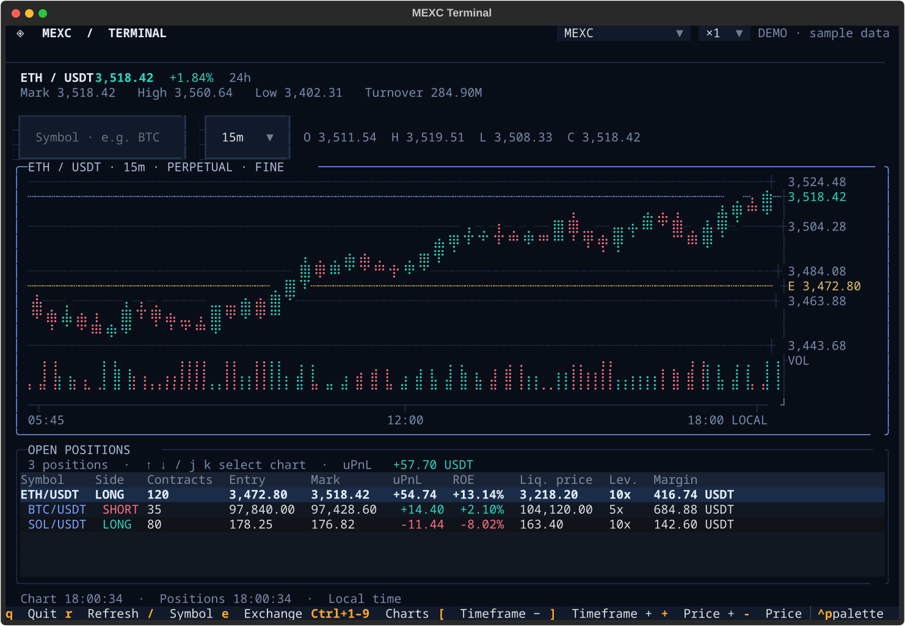
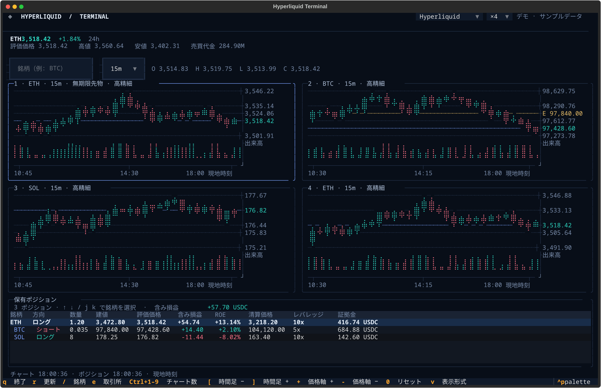
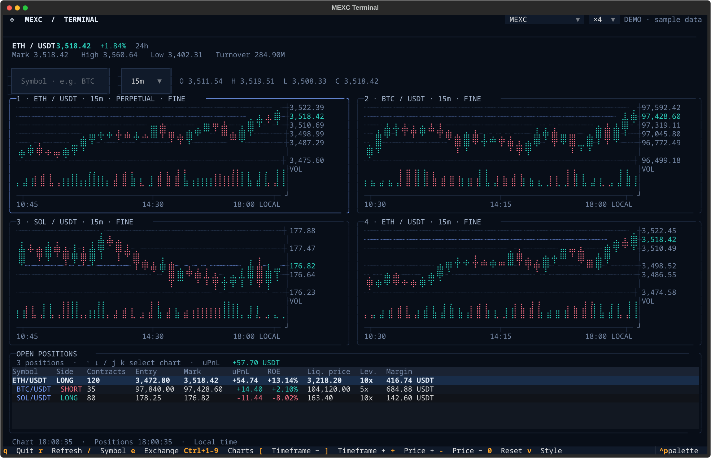

# perpetui

Hyperliquid・Lighter・MEXC の先物チャート・保有ポジションを表示する Python 製 TUI です。



- 上部：価格・24時間騰落率、ローソク足、出来高、価格軸・時刻軸。
- 下部：保有ポジション、方向、数量、建値、マーク価格、含み損益、ROE、清算価格。
- 起動時は API が返す保有ポジションの先頭銘柄を表示。ポジションがなければ BTC を表示します。
- ポジション選択でチャート切り替え。足・価格・ポジション・含み損益はWebSocketで随時更新。
- 初回取得・再接続時の同期と切断時の補完はRESTを使用。
- `mexc-cli`・`hl`・`lighter` の保存済みアカウント、または環境変数から設定を読み込みます。
- 日本語・英語の表示に対応しています。

## 起動

Python 3.11以上と [uv](https://docs.astral.sh/uv/) を使用します。

```bash
uv sync --dev
uv run perpetui --demo
uv run perpetui
```

pipの場合：

```bash
python3 -m venv .venv
.venv/bin/pip install -e .
.venv/bin/perpetui --demo
```

```bash
perpetui --demo-empty             # ポジションなし → BTCのサンプルチャート
perpetui --public                 # 認証設定を読まず公開相場のみ表示
perpetui --symbol SOL --interval 1h --refresh 10
perpetui --account main
perpetui --no-websocket           # チャート・ポジションともRESTで定期取得
```

認証情報が未設定の場合は、公開データでチャートを表示し、保有ポジション欄を非表示にします。
`--public` でも同じ表示になります。空いた領域はチャートに使用します。
認証情報が設定されていて保有ポジションがない場合は、ポジション欄にその旨を表示します。
Hyperliquid は秘密鍵なしでも、監視対象のウォレットアドレスがあればポジションを表示できます。
Lighter も秘密鍵や認証トークンなしで、アカウント番号だけでポジションを表示できます。

## 取引所の選択

既定の取引所は Hyperliquid です。Lighter は `--exchange lighter`（または `lt`）、
MEXC は `--exchange mexc` を指定します。

```bash
uv run perpetui --exchange hyperliquid
uv run perpetui --exchange hyperliquid --public
uv run perpetui --exchange hyperliquid --symbol xyz:CL
uv run perpetui --exchange hyperliquid --demo
uv run perpetui --exchange hyperliquid --testnet

uv run perpetui --exchange lighter
uv run perpetui --exchange lighter --public
uv run perpetui --exchange lighter --symbol HYPE
uv run perpetui --exchange lighter --demo
uv run perpetui --exchange lighter --testnet

uv run perpetui --exchange mexc
uv run perpetui --exchange mexc --public
uv run perpetui --exchange mexc --symbol SOL_USDT
```

| 取引所 | ポジションがない場合 | 銘柄の例 | 数量の単位 |
| --- | --- | --- | --- |
| Hyperliquid | `BTC` | `BTC`、`HYPE`、`kPEPE`、`xyz:CL` | 銘柄の実数量 |
| Lighter | `BTC` | `BTC`、`HYPE`、`1000PEPE` | 銘柄の実数量 |
| MEXC | `BTC_USDT` | `BTC`、`ETH_USDT` | 契約枚数 |

Hyperliquid は通常の無期限先物と、HIP-3 のビルダーが提供する先物を対象にします。
Lighter は公開されている無期限先物（perp）を対象にします。
起動後は上部の取引所選択欄、または `e` で Hyperliquid・Lighter・MEXC を切り替えられます。
選択先の設定を読み直し、保有ポジションの先頭銘柄を表示します。
ポジションがなければ BTC を表示します。設定の読み込みに失敗した場合は元の画面を維持します。
`--account` と `--websocket-url` は起動時に選んだ取引所に適用し、
ほかの取引所には保存済みデフォルト設定や取引所別の環境変数を使用します。
`--public`・`--demo`・`--no-websocket` は切り替え後も適用されます。



## 表示言語

`--lang ja` で日本語、`--lang en` で英語を選択できます。

```bash
uv run perpetui --lang ja
uv run perpetui --exchange hyperliquid --lang en
uv run perpetui --lang ja --help
```

言語を指定しない場合は `PERPETUI_LANG`、`LANGUAGE`、`LC_ALL`、`LC_MESSAGES`、`LANG` の
順に設定を読み取ります。未設定または未対応の言語の場合は英語になります。
翻訳は `src/perpetui/locales/ja.json` で管理しています。

## 複数チャート

`Ctrl + 1〜9` でチャートの表示数を変更できます。上部の `×1` などの選択欄でも変更できます。
各枠は同じ取引所の銘柄を表示し、追加時は保有銘柄や BTC・ETH・SOL を初期表示に使用します。

操作する枠をクリックするか、`Tab` または数字キー `1`〜`9` で選択してください。
選択中の枠は青い枠線で示されます。
銘柄検索、ポジション一覧からの銘柄選択、時間足、価格軸の拡大、表示形式は選択中の枠に反映されます。
`z` で選択中の枠だけを最大化し、もう一度押すと元のグリッドに戻ります。
`a` で全チャートの時間足同期を有効にすると、`[` / `]` や時間足セレクタの変更が全枠に適用されます。
`Shift + [` / `Shift + ]` は同期設定を変えずに今回だけ全枠の時間足を変更します。
`s` を有効にすると、選択中の足の時刻をほかのチャートにも反映し、同じ時点を比較できます。
`r` は全枠を更新します。取引所を切り替えると、表示数・時間足・表示形式を引き継いで全枠を読み直します。
`Ctrl + 1` で 1 枠に戻すと、削除した枠の通信を終了します。

2 枠は 80 列 × 24 行、4 枠は 160 列 × 50 行、9 枠は 180 列 × 65 行以上が目安です。



### Konsole のキー設定

Konsole の標準設定では `Ctrl + 数字` を区別して送信できない場合があります。
反応しない場合は、Konsole を実行している環境で専用キーマップをインストールしてください。

```bash
uv run perpetui --install-konsole-keymap
```

Konsole の TUI 用プロファイルの「キーボード」で `perpetui (Ctrl+1-9)` を選択します。
このコマンドは専用キーマップを追加し、既存のプロファイル設定は変更しません。
端末と TUI が別の環境にある場合は、
[キーマップ](src/perpetui/resources/konsole.keytab) を端末側の
`~/.local/share/konsole/perpetui.keytab` に保存して選択できます。

## リアルタイム更新

### Hyperliquid

[Hyperliquid API](https://hyperliquid.gitbook.io/hyperliquid-docs/for-developers/api) の
`candleSnapshot` で履歴を取得し、WebSocket の `candle` と `activeAssetCtx` で足・評価価格を更新します。
アカウントを設定した場合は `allDexsClearinghouseState` で全 DEX のポジションを受信します。
チャートの表示銘柄を変えても、ほかの保有銘柄の更新を続けます。

接続が切れた場合は REST で全 DEX の状態を再取得し、再接続します。
足の欠損も REST で補い、古い足やポジション通知による巻き戻りを防ぎます。
Hyperliquid の 24 時間高値・安値はこの API から取得できないため、`—` と表示します。

### Lighter

[Lighter API](https://docs.lighter.xyz/api/readme) の `candles` で履歴を取得し、
WebSocket の `candle` と `market_stats` で足・評価価格・24時間騰落率・売買代金を更新します。
アカウント番号を設定した場合は `account_all_positions` で保有ポジションを受信します。
どちらも公開チャネルで、秘密鍵・APIキー・認証トークンは使用しません。
チャートの表示銘柄を変えても、ほかの保有銘柄の更新を続けます。

接続が切れた場合は REST でポジションと足を再取得し、再接続します。
15秒ごとにpingを送信し、切断時は1〜30秒の間隔で再接続します。
Lighter の時間足は `1m / 5m / 15m / 30m / 1h / 4h / 1d` です。
Lighter のレバレッジはポジションの初期証拠金率から算出し、
クロスポジションの証拠金は初期証拠金の推定値を表示します。

### MEXC

通常起動では、RESTで直近160本の足を取得してから、
[MEXC先物WebSocket](https://www.mexc.com/api-docs/futures/websocket-api/native-ws-endpoint)
の `sub.kline` と `sub.ticker` を購読します。同じ時間の足は受信したOHLCVで置き換え、
次の時間の足は末尾へ追加します。出来高は累積値のため、受信ごとに足し込みません。
画面下部でチャートとポジションの更新時刻を確認できます。

足データとtickerは送信時刻を照合し、古いtickerで現在値を巻き戻さないようにしています。
未確定足も受信ごとに終値・高値・安値・出来高を更新します。

15秒ごとにpingを送信し、切断・受信停止時は1〜30秒の間隔で再接続します。
再接続時や足の欠損を検出した場合は、RESTで履歴を再取得します。
接続できない間も、既定で5秒ごとにRESTでチャートを更新します。
銘柄・時間足の変更や終了時には、前の接続を終了します。

認証済みの場合、チャートとは別の接続で
[ポジション通知](https://www.mexc.com/api-docs/futures/websocket-api/position)
を購読し、新規建玉・数量変更・決済・建値・証拠金の変更を反映します。
所有銘柄すべての[評価価格](https://www.mexc.com/api-docs/futures/websocket-api/fair-price)
を購読し、価格が変わるたびにマーク価格・uPnL・ROE・合計uPnLを再計算します。
チャートに表示していない銘柄や両建ての各ポジションも対象です。
ポジションがない場合も変更通知を待機し、新規銘柄の価格購読を自動で追加します。

変更通知はバージョン・時刻を照合し、
古い通知で数量を巻き戻したり決済済みの行を復活させたりしないようにしています。
接続確立後にRESTで再同期して接続前・切断中の変更を補い、
接続中はポジションの定期REST取得を止めます。`r` はRESTで再取得して接続も張り直します。
ポジション接続にも15秒ごとのpingと1〜30秒の再接続待機を使用します。

### 接続設定

`--refresh` は接続できない間のRESTフォールバックの更新間隔です（既定5秒）。
`--no-websocket` で常時REST更新に切り替えられます。デモもREST相当の定期更新です。

Hyperliquid の接続先は `https://api.hyperliquid.xyz` と `wss://api.hyperliquid.xyz/ws` です。
`HYPERLIQUID_BASE_URL`・`HYPERLIQUID_WS_URL`、または
`--hyperliquid-base-url`・`--websocket-url` で変更できます。
Lighter の接続先は `https://mainnet.zklighter.elliot.ai` と
`wss://mainnet.zklighter.elliot.ai/stream` です。
Lighter は `LIGHTER_BASE_URL`・`LIGHTER_WS_URL`、または
`--lighter-base-url`・`--websocket-url` で変更できます。
MEXC の接続先は `wss://contract.mexc.com/edge` が既定です。
`MEXC_WS_URL` または `--websocket-url` で変更できます。WebSocketの公開相場購読にAPIキーは不要です。
`--testnet` では選択した取引所の接続先をテストネットに切り替えます。

## Hyperliquid の設定

[参照 CLI の hl](https://github.com/haturatu/hl) で設定済みの場合は、
`~/.hl/hl.db` のデフォルトアカウントから監視先のアドレスを読み込みます。
データベースの作成・変更・マイグレーションは行いません。
API ウォレットの秘密鍵は読み込みません。ポジションの取得に必要なのは監視先アドレスだけです。

```bash
uv run perpetui --exchange hyperliquid --account main
uv run perpetui --exchange hyperliquid --hl-command /original/path/to/hl
```

復号にはアカウント保存時の `hl` コマンドの絶対パスを使用します。
通常は PATH から検出します。`HL_COMMAND`・`--hl-command` で明示でき、
データベースのディレクトリは `HL_HOME` で指定できます。
`--testnet` ではテストネット用アカウントを選択します。

保存済みアカウントがない場合は `HYPERLIQUID_WALLET_ADDRESS` を使用します。
`0x...` は監視する本体アカウントまたはサブアカウントの完全なアドレスに置き換えてください。

```bash
export HYPERLIQUID_WALLET_ADDRESS='0x...'
uv run perpetui --exchange hyperliquid
uv run perpetui --exchange hyperliquid --wallet-address "$HYPERLIQUID_WALLET_ADDRESS"
```

`--wallet-address` は保存済み設定より優先されます。
監視先を設定しない場合や `--public` を指定した場合は、公開相場のみを表示します。

## Lighter の設定

[参照 CLI の lighter](https://github.com/haturatu/ligher-xyz-cli) でアカウントを保存済みの場合は、
`~/.config/ligher-xyz-cli/accounts.db` のデフォルトアカウントから
ネットワーク別のアカウント番号を読み込みます。データベースの作成・変更・マイグレーションは行いません。
秘密鍵・APIキー・認証トークンは読み込みません。

```bash
uv run perpetui --exchange lighter --account main
uv run perpetui --exchange lighter --testnet
uv run perpetui --exchange lighter --lighter-config /path/to/accounts.db
```

`--account` で保存済みアカウント名を選択でき、`--lighter-account-index` は保存済み設定より優先されます。
`LIGHTER_CONFIG` でデータベースの場所、`LIGHTER_ACCOUNT_INDEX` でアカウント番号を指定できます。
`--testnet` ではテストネット用の保存済みアカウントを選択します。

```bash
export LIGHTER_ACCOUNT_INDEX=12345
uv run perpetui --exchange lighter
uv run perpetui --exchange lighter --lighter-account-index 12345
```

アカウント番号を設定しない場合や `--public` を指定した場合は、公開相場のみを表示します。

## MEXC の設定

[参照CLI](https://github.com/haturatu/mexc-cli) で `mexc account add` 済みなら、
`~/.mexc/mexc.db` のデフォルトアカウントを読み取ります。`MEXC_HOME` にも対応します。
データベースの作成・更新・マイグレーションは行いません。

既存CLIの暗号化キーはインストールされた `mexc` コマンドの絶対パスから導出されます。
通常はPATHから自動検出します。移動した場合は、アカウント保存時のパスを指定してください。

```bash
perpetui --exchange mexc --mexc-command /original/path/to/mexc
```

環境変数でも指定できます。両方設定されている場合は保存済みデフォルトより優先します。
`--account` を指定すると、その保存済みアカウントを優先します。

```bash
export MEXC_API_KEY='...'
export MEXC_API_SECRET='...'
perpetui --exchange mexc
```

認証設定がなければ公開相場モードでBTCを表示します。認証・通信エラーは画面下部に表示し、
最後に取得できたデータを残して再試行します。初回にポジション取得が失敗した場合もBTCを表示します。

## 操作

| キー | 操作 |
| --- | --- |
| `1`〜`9` | 対応する番号のチャートを選択（入力欄・選択欄の編集中は無効） |
| `↑` / `↓`、`j` / `k` | 所有ポジション選択・チャート切り替え |
| `/` | 銘柄検索へ移動。入力欄の下に候補を表示。↑↓で選択しEnter、またはクリックで確定 |
| `e` | 取引所の選択欄を開く |
| `Ctrl + 1〜9` | チャートの表示数を変更 |
| `←` / `→` | 選択チャートの前 / 次の足を表示（履歴モード） |
| `Shift + ←` / `Shift + →` | 5本ずつ移動 |
| `Home` / `End` | 最古の読み込み済み足 / 最新足に戻ってリアルタイム追従 |
| `PageUp` / `PageDown` | 1画面分の履歴を移動 |
| `[` / `]` | 選択チャートの前 / 次の時間足 |
| `Shift + [` / `Shift + ]` | 全チャートの時間足を一括変更 |
| `a` | 全チャートの時間足同期を ON / OFF |
| `s` | 選択チャートのカーソル時刻を全チャートへ同期 |
| `+` / `-`（`=`でも拡大） | 価格軸を拡大 / 縮小（最大64倍） |
| `0` | 価格軸の拡大をリセット |
| `Ctrl + ↑` / `Ctrl + ↓` | 表示するローソク足の本数を増やす / 減らす |
| `v` | ローソク足・出来高の高精細表示（FINE）/ 塗りつぶし表示（SOLID）を切り替え |
| `z` | 選択チャートを最大化 / 元に戻す |
| `p` | ポジション一覧の表示 / 非表示 |
| `?` | キーボードショートカット一覧を表示 |
| `Ctrl + P` | コマンドパレットを開く |
| `Tab` | 取引所・入力欄・時間足・チャート・ポジション間を移動 |
| `Esc` | ポジション一覧へ戻る |
| `r` | 即時更新 |
| `q` / `Ctrl+C` | 終了 |

`←` / `→` で履歴モードに入ると、チャート右上に `HISTORY -N` と選択中の足の
日時・OHLC・出来高を表示します。`End` で `LIVE` に戻ります。
履歴の先頭に近づくと、MEXC・Hyperliquid・Lighter の REST API から古い足を追加取得し、
同じ銘柄・時間足のチャート間でキャッシュを共有します。WebSocket は履歴表示中も継続します。

時間足は `1m / 5m / 15m / 30m / 1h / 4h / 1d / 1w`（Lighter は `1w` を除く `1m / 5m / 15m / 30m / 1h / 4h / 1d`）。
銘柄検索は大文字・小文字を区別しない部分一致で、完全一致・前方一致を優先します。
例えば `ZE` で `ZEC / USDT`、`OIL` で `UKOIL / USDT`・`USOIL / USDT` などの候補を
最大8件表示します。候補は起動時に選択した取引所の公開銘柄一覧から取得し、入力中は手元で絞り込みます。
`BTC`、`ETHUSDT`、`SOL_USDT`、`ZEC/USDT` 形式に対応。候補がない場合や一覧取得に失敗した場合も
銘柄を直接入力してEnterで表示できます。`Esc` で検索を閉じてポジション一覧へ戻ります。

黄色の `E` は選択ポジションの建値（表示価格範囲内の場合）。時刻は端末のローカルタイムです。
標準のFINE表示は点字マーカーを使い、実体・ヒゲ・出来高ともに1/4行単位で描画します。
点は太字で表示します。実際の点の大きさ・太さは端末フォントに依存します。
`v` で塗りつぶし表示（SOLID、実体は1/2行・ヒゲは1行単位）にも切り替えられます。
端末の解像度より小さな変化は同じ位置に重なるため、さらに細かく見る場合は `+` で価格軸を拡大できます。
拡大の中心は操作時の終値に固定するため、その後の値動きが見えます。
120列 × 40行以上を推奨します。小さい画面では一覧を横スクロールできます。

ポジションの `Contracts` は契約枚数です。USDT/USDC建て先物の含み損益は、
`(マーク価格 − 建値) × 契約枚数 × contractSize × 売買方向` で計算します。
ROEは含み損益 / 証拠金で、手数料・資金調達料を含みません。
銘柄情報やマーク価格の取得に失敗した場合、該当値は `—` となります。
インバース契約の含み損益・ROEは未対応のため `—` と表示します。合計は決済通貨ごとに表示します。
Hyperliquid の含み損益・ROE は取引所が返す値を表示し、数量は実数量として扱います。

## API・開発

チャート描画は [Plotext 6](https://github.com/piccolomo/plotext) を使用しています。
ローソク足・出来高を上下のパネルに描画し、ANSI出力をRich Textに変換してTextualに表示します。
実体はPlotextの矩形、ヒゲは線分を使い、両者の列を揃えています。
FINEでは実体・ヒゲ・出来高に点字マーカー（1文字内を縦4×横2に分割）を使用します。
表示領域に合わせて直近の足を描画し、データ・建値・画面サイズが変わったときに再描画します。

APIは参照CLIと同様に [MEXC Futures API](https://www.mexc.com/api-docs/futures/integration-guide)
を利用し、[ドメイン更新案内](https://www.mexc.com/announcements/article/futures-api-access-domain-update-17827791532974)
に合わせて `https://api.mexc.com` を既定にしています。
`MEXC_FUTURES_BASE_URL`、`MEXC_BASE_URL`、`--futures-base-url` で変更できます。
注文・決済・アカウント変更の機能はありません。

```bash
uv run pytest
uv run ruff check .
uv run ruff format --check .
uv build
```

`make setup / run / demo / check / build` でも実行できます。

ログはDEBUG/INFOをstdout、WARN/ERRORをstderrへ出力します。起動不能のエラーはstderrへ出力して
終了コード1で終了します。APIキー・署名・レスポンス本文はログに出しません。
