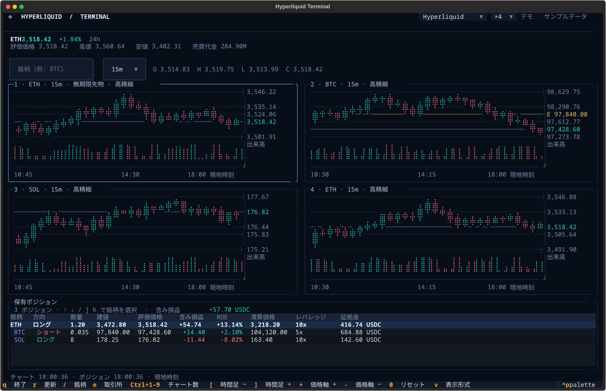

# Exchanges and connection settings

**English** | [日本語](exchanges.ja.md)

perpetui can display futures charts and positions for Hyperliquid, Lighter, and MEXC.

However, the information needed to monitor positions differs by exchange. Hyperliquid and Lighter allow public position monitoring, while MEXC requires authentication.

MEXC also reports quantities as numbers of contracts, whereas the other two exchanges report actual asset quantities. Keep this distinction in mind when comparing positions.

## Select an exchange

Hyperliquid is selected when no exchange is specified.

```sh
perpetui --exchange hyperliquid
perpetui --exchange hyperliquid --public
perpetui --exchange hyperliquid --symbol xyz:CL
perpetui --exchange hyperliquid --demo
perpetui --exchange hyperliquid --testnet

perpetui --exchange lighter
perpetui --exchange lighter --public
perpetui --exchange lighter --symbol HYPE
perpetui --exchange lighter --demo
perpetui --exchange lighter --testnet

perpetui --exchange mexc
perpetui --exchange mexc --public
perpetui --exchange mexc --symbol SOL_USDT
```

`lighter` can be abbreviated as `lt`.

| Exchange | Default symbol when there are no positions | Example symbols | Quantity unit |
| --- | --- | --- | --- |
| Hyperliquid | `BTC` | `BTC`, `HYPE`, `kPEPE`, `xyz:CL` | Actual asset quantity |
| Lighter | `BTC` | `BTC`, `HYPE`, `1000PEPE` | Actual asset quantity |
| MEXC | `BTC_USDT` | `BTC`, `ETH_USDT` | Number of contracts |

Hyperliquid supports both standard perpetual futures and builder-deployed HIP-3 futures. Lighter supports its publicly listed perpetual futures.

You can switch exchanges after startup using the selector at the top or the `e` key. The application reloads the chosen exchange's configuration and, if it has positions, displays the first position's symbol. If switching fails, the previous screen remains.

To monitor multiple wallets or exchanges concurrently, see the [combined portfolio configuration in the README](../README.md#multiple-accounts-and-combined-portfolios). The `account` field in the configuration file names an account saved by the relevant CLI. Hyperliquid's `wallet_address` and Lighter's `lighter_account_index` identify public accounts to monitor. Do not store MEXC secrets in TOML.

At startup, `--account` and `--websocket-url` apply only to the initially selected exchange. After switching, exchange-specific saved settings and environment variables are used. By contrast, `--public`, `--demo`, and `--no-websocket` remain effective.



## Hyperliquid

### How market data is fetched

Historical candles come from `candleSnapshot` in the [Hyperliquid API](https://hyperliquid.gitbook.io/hyperliquid-docs/for-developers/api). WebSocket `candle` and `activeAssetCtx` subscriptions update charts and mark prices.

When a wallet address is configured, `allDexsClearinghouseState` is used to monitor positions across all DEXs. Switching the visible chart does not stop updates for other held assets.

On disconnect, the application refetches positions and candles over REST before reconnecting. Missing candles are also backfilled by REST, and stale notifications cannot roll data back.

This API does not provide the 24-hour high and low values needed by the UI, so those fields show `—`.

### Specify a wallet to monitor

If you use the [hl CLI](https://github.com/haturatu/hl), perpetui can read the default account from `~/.hl/hl.db`. It never creates, modifies, or migrates that database.

```sh
perpetui --exchange hyperliquid --account main
perpetui --exchange hyperliquid --hl-command /original/path/to/hl
```

When reading saved information, the absolute path of the `hl` command used when the account was saved may be required. Specify it with `HL_COMMAND` or `--hl-command`. Use `HL_HOME` to change the database location.

A private key is not needed to retrieve positions. If you know the address of the wallet to monitor, you can specify it directly:

```sh
export HYPERLIQUID_WALLET_ADDRESS='0x...'
perpetui --exchange hyperliquid
perpetui --exchange hyperliquid --wallet-address "$HYPERLIQUID_WALLET_ADDRESS"
```

Replace `0x...` with a real account or subaccount address. `--wallet-address` takes precedence over saved configuration.

`--testnet` selects saved testnet accounts. If no monitor target is provided, or if `--public` is set, only public market data is shown.

## Lighter

### Market and position updates

History comes from the `candles` endpoint of the [Lighter API](https://docs.lighter.xyz/api/readme). WebSocket `candle` and `market_stats` subscriptions update candles, mark prices, 24-hour price changes, and trading volume.

With an account index, positions can be retrieved using `account_all_positions`. **No private keys, API keys, or authentication tokens are used.** Both are public channels.

After a disconnect, candles and positions are reloaded over REST. The client sends a ping every 15 seconds and reconnects with delays from 1 to 30 seconds.

Supported Lighter intervals are `1m`, `5m`, `15m`, `30m`, `1h`, `4h`, and `1d`. `1w` is not supported.

Leverage is derived from the initial margin ratio, and cross-position margin is estimated from initial margin. These figures are not necessarily identical to the exchange's precise values.

### Specify an account to monitor

If you have configured the [existing lighter CLI](https://github.com/haturatu/ligher-xyz-cli), perpetui can read the account index from its default account in `~/.config/ligher-xyz-cli/accounts.db`.

```sh
perpetui --exchange lighter --account main
perpetui --exchange lighter --testnet
perpetui --exchange lighter --lighter-config /path/to/accounts.db
```

Use `LIGHTER_CONFIG` to specify the file path, or `LIGHTER_ACCOUNT_INDEX` / `--lighter-account-index` to specify an account index. An explicitly supplied index takes precedence over saved settings.

```sh
export LIGHTER_ACCOUNT_INDEX=12345
perpetui --exchange lighter
perpetui --exchange lighter --lighter-account-index 12345
```

The database is never created or modified. `--testnet` selects a testnet account. Without account settings, only public market data is shown.

## MEXC

### REST and WebSocket

MEXC initially fetches the latest 160 candles over REST, then subscribes to `sub.kline` and `sub.ticker` via its [futures WebSocket](https://www.mexc.com/api-docs/futures/websocket-api/native-ws-endpoint).

Candles with matching timestamps are replaced with the received OHLCV; a candle for a new interval is appended. Because volume is cumulative, updates are not added together.

A ping is sent every 15 seconds. On disconnect or stalled reception, the application reconnects with delays from 1 to 30 seconds. Missing candles are backfilled over REST. While WebSocket is unavailable, the chart is updated from REST every five seconds by default.

No API key is required to subscribe to public market data.

### Monitor positions

Monitoring MEXC positions requires an API key and secret.

Once authenticated, perpetui subscribes to [position notifications](https://www.mexc.com/api-docs/futures/websocket-api/position) on a separate WebSocket. Changes to newly opened positions, quantities, closures, entry prices, margin, and similar fields are reflected in the interface.

It also subscribes to [fair prices](https://www.mexc.com/api-docs/futures/websocket-api/fair-price) for every held symbol to update mark prices, unrealized PnL, ROE, and total unrealized PnL. This includes positions on symbols not displayed in the charts, as well as hedged positions.

Notification versions and timestamps are compared so old updates cannot restore closed positions or roll quantities back. The state is synchronized with REST once more after connecting, after which periodic REST position polling stops.

Press `r` to refetch positions via REST and reconnect. If connectivity is lost, the last known information remains visible while retries continue.

### Configure API keys

If you saved an account with [mexc-cli](https://github.com/haturatu/mexc-cli), perpetui can read the default account from `~/.mexc/mexc.db`. `MEXC_HOME` is supported.

The existing CLI derives its encryption key from the absolute path of the installed `mexc` command. If that command has moved, specify **the original path used when saving the account**:

```sh
perpetui --exchange mexc --mexc-command /original/path/to/mexc
```

You can supply the key and secret via environment variables as well. When both are set, they take precedence over the saved default. If `--account` is explicitly specified, that named saved account is preferred.

```sh
export MEXC_API_KEY='...'
export MEXC_API_SECRET='...'
perpetui --exchange mexc
```

Never paste real keys into shell history, issues, or logs. Although perpetui does not place or close orders, it is safer to limit the permissions of API credentials independently.

If there are no credentials, only public market data is shown and the initial symbol is BTC.

## Endpoints and refresh intervals

Use exchange-specific environment variables or CLI options to override connection endpoints.

| Exchange | Default REST / WebSocket endpoint | Override |
| --- | --- | --- |
| Hyperliquid | `https://api.hyperliquid.xyz` / `wss://api.hyperliquid.xyz/ws` | `HYPERLIQUID_BASE_URL`, `HYPERLIQUID_WS_URL`, `--hyperliquid-base-url`, `--websocket-url` |
| Lighter | `https://mainnet.zklighter.elliot.ai` / `wss://mainnet.zklighter.elliot.ai/stream` | `LIGHTER_BASE_URL`, `LIGHTER_WS_URL`, `--lighter-base-url`, `--websocket-url` |
| MEXC | `wss://contract.mexc.com/edge` (WebSocket) | `MEXC_WS_URL`, `--websocket-url` |

`--refresh` controls the REST refresh interval when WebSocket cannot be used. The default is five seconds. `--no-websocket` starts with periodic REST polling instead of WebSocket.

`--testnet` changes the selected exchange's endpoints to the testnet environment. Available functionality differs by exchange.

[Back to README](../README.md)
