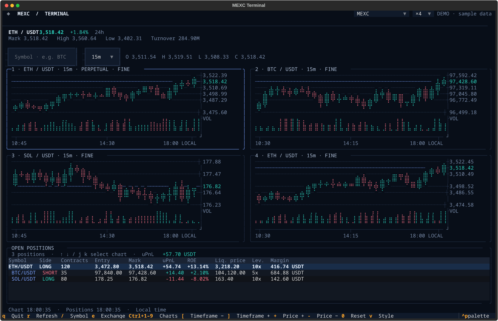

# Usage

**English** | [日本語](usage.ja.md)

perpetui can be operated entirely from the keyboard. With several charts open, the main thing to keep track of is which pane is currently active.

## Display language

The interface supports Japanese, English, Russian, and Simplified and Traditional Chinese.

```sh
perpetui --lang ja
perpetui --lang ru
perpetui --lang zh-cn
perpetui --lang zh-tw
perpetui --exchange hyperliquid --lang en
perpetui --lang ja --help
```

If `--lang` is omitted, the application checks `PERPETUI_LANG`, `LANGUAGE`, `LC_ALL`, `LC_MESSAGES`, and `LANG` in that order. Locale names such as `zh_CN.UTF-8` and `zh_TW.UTF-8` are mapped to `zh-cn` and `zh-tw`. The fallback for an unset or unsupported language is English. Translation strings are stored in JSON files under `src/perpetui/locales/`.

## Add more charts

Use `Ctrl + 1–9` or the `×1`, etc. selector at the top to change how many charts are visible.

Click a pane or use `Tab` or the number keys `1`–`9` to make it active. The selected pane has a blue border. Symbol search, interval changes, and price-axis zoom apply to that pane.

Press `z` to maximize the selected pane; press it again to restore the layout.

### Why use an automatic layout?

Putting three charts in a 2 × 2 grid wastes one cell. On a wide terminal, making too many vertical splits also makes the charts harder to read.

The default **Auto** mode therefore chooses a layout based on the terminal's width, height, and chart count. It can arrange three charts as one above two, or five as three above two, widening panes to reduce empty space.

You can select Auto / Horizontal / Grid / Vertical manually with `l` or the selector at the top. Manual layouts persist when the terminal is resized.

**Changing the layout does not recreate charts.** History cursors, connections, and rendering modes are preserved.



### Sync intervals and cursors

Press `a` to toggle interval synchronization across all charts. While enabled, `[` / `]` changes the interval in every pane.

To change all intervals once without toggling synchronization, use `Shift + [` / `Shift + ]`.

Press `s` to copy the selected chart's cursor timestamp to the other charts. This is useful when comparing different symbols at the same point in time.

Press `r` to reload all charts. The number of panes, intervals, and rendering modes are retained when switching exchanges.

## Show only as much of the positions panel as needed

A list with no positions would only waste screen space, so the panel automatically collapses when the count is zero.

With a few positions, the panel is just tall enough for them. With many positions, it scrolls within approximately 25% of the terminal height, up to 12 rows. Narrow terminals also have space for horizontal scrolling.

Errors leave a warning visible. Press `p` to manually show or hide the panel, or `Shift + P` to return to automatic behavior.

Approximate terminal sizes for multiple charts are 80 × 24 for two panes, 160 × 50 for four, and 180 × 65 for nine. At least 120 × 40 is recommended if space allows.

## Keyboard shortcuts

| Key | Action |
| --- | --- |
| `1`–`9` | Select the corresponding chart; disabled while editing an input field |
| `↑` / `↓`, `j` / `k` | Select positions and move between charts |
| `/` | Search for symbols; select a suggestion and press Enter |
| `e` | Open exchange selector |
| `l` | Open layout selector |
| `Ctrl + 1–9` | Change the number of chart panes |
| `←` / `→` | Move to previous/next candle |
| `Shift + ←` / `Shift + →` | Move five candles at a time |
| `Home` / `End` | Jump to oldest loaded / latest candle |
| `PageUp` / `PageDown` | Move one screen |
| `[` / `]` | Change the selected chart's interval |
| `Shift + [` / `Shift + ]` | Change all chart intervals |
| `a` | Toggle interval synchronization |
| `s` | Sync cursor time to other panes |
| `+` / `-` (`=` also zooms in) | Zoom price axis in/out, up to 64× |
| `0` | Reset price-axis zoom |
| `Ctrl + ↑` / `Ctrl + ↓` | Increase/decrease the number of displayed candles |
| `v` | Switch between FINE / SOLID rendering |
| `z` | Maximize / restore chart |
| `p` / `Shift + P` | Toggle positions manually / restore automatic visibility |
| `?` | Show keyboard shortcuts |
| `Ctrl + P` | Open command palette |
| `Tab` | Change focus |
| `Esc` | Return to the positions panel |
| `r` | Refresh immediately |
| `q` / `Ctrl + C` | Quit |

## History and live display

When you browse older candles with `←` / `→`, the top right displays `HISTORY -N` along with the timestamp, OHLC, and volume. Press `End` to return to `LIVE`.

Approaching the start of the loaded history triggers a REST request for older candles. Panes showing the same symbol and interval share their history cache. WebSocket subscriptions continue while you browse historical candles.

Available intervals are `1m`, `5m`, `15m`, `30m`, `1h`, `4h`, `1d`, and `1w`. Lighter does not support `1w`, so its longest interval is `1d`.

## Symbol search

Press `/` to display up to eight suggestions below the input field. Matching is case-insensitive, with exact and prefix matches prioritized.

For example, `ZE` may suggest `ZEC / USDT`, while `OIL` may suggest `UKOIL / USDT` and `USOIL / USDT`. Inputs such as `BTC`, `ETHUSDT`, `SOL_USDT`, and `ZEC/USDT` are also accepted.

Suggestions are filtered locally from the symbol list initially retrieved from the active exchange. Even if fetching that list fails, you can type a symbol manually and press Enter. Press `Esc` to close search.

## Chart display details

FINE uses Braille markers, dividing each character into a 2 × 4 grid to render candle bodies, wicks, and volume. Press `v` to switch to SOLID, where bodies have half-line resolution and wicks have full-line resolution.

Braille dot thickness and appearance depend on the font. Price movements smaller than the current screen resolution overlap, so press `+` to zoom the price axis if you need more detail.

The yellow `E` on the chart marks a position's entry price. Timestamps use the terminal's local time.

### Position PnL

For exchanges such as MEXC, `Contracts` means the number of contracts. Unrealized PnL for USDT/USDC-settled futures is calculated as:

```text
(mark price - entry price) × number of contracts × contractSize × position direction
```

ROE is unrealized PnL divided by margin; fees and funding payments are excluded. If price or symbol details are unavailable, the UI shows `—`. Unrealized PnL and ROE for inverse contracts are not supported.

For Hyperliquid, the displayed PnL and ROE come from the exchange. Quantities represent actual asset amounts rather than contract counts. Total PnL is displayed by settlement currency.

## If Ctrl + number does not work in Konsole

Konsole's default keymap may not send `Ctrl + 1–9` in a form the application can distinguish.

```sh
uv run perpetui --install-konsole-keymap
```

After running this command, select `perpetui (Ctrl+1-9)` from the Konsole TUI profile. The command does not automatically overwrite your existing profile.

If the terminal runs on another machine, copy the [keymap](../src/perpetui/resources/konsole.keytab) to `~/.local/share/konsole/perpetui.keytab` on the terminal host and select it.

[Back to README](../README.md)
